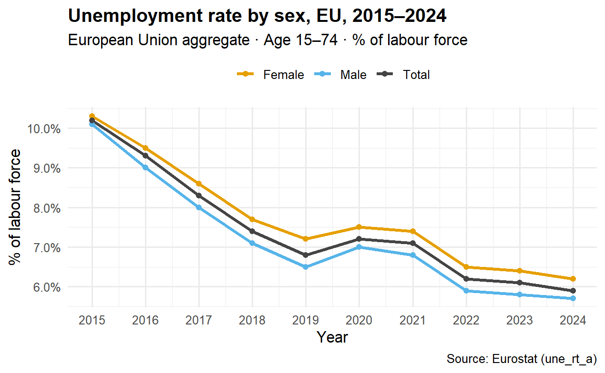
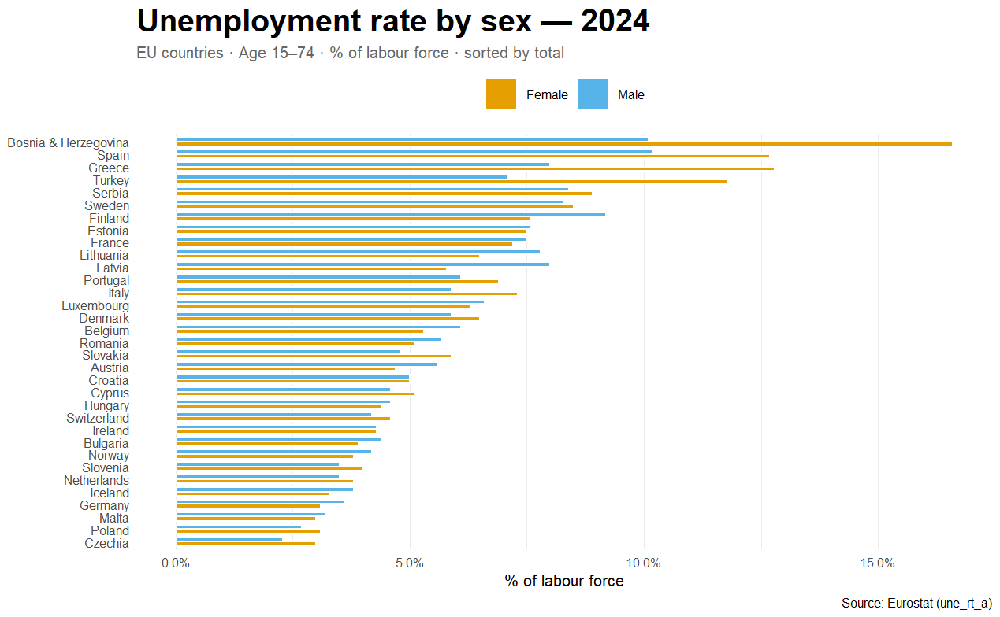

**Unemployment in Europe: a Visualization Redesign (STAT 515)**

Redesigning a set of Eurostat unemployment charts in R so the story is clear at a glance.

Read the full report (no R needed): https://rutvij1407.github.io/Mid_STAT-515_Visualizations-project-output/report.html

Project page: https://rutvij1407.github.io/Mid_STAT-515_Visualizations-project-output/

**The problem**

Unemployment statistics are easy to publish and hard to read. Raw tables and cluttered default charts hide what people want to know: how unemployment has moved over time, and how countries and genders differ. This project rebuilds the charts with clear titles, a colour blind safe palette, sorted comparisons and small multiples.

**The data**

* Source: Eurostat, pulled live in R with the eurostat package.
* Tables: une_rt_a (annual unemployment rate by sex and age) and une_ltu_a (long term unemployment).
* Scope: ages 15 to 74, as a percentage of the labour force, 2015 to 2024.

**Methods**

1. Pull and filter the Eurostat tables, dropping aggregates such as the euro area and EFTA for country level charts.
2. Convert country codes to names with the countrycode package.
3. Redesign each chart with ggplot2, using a consistent palette, sorted bars and small multiples.

Tools: R, tidyverse, ggplot2, eurostat, countrycode, R Markdown.

**Key findings**

* Unemployment across the EU fell from about 10 percent in 2015 to about 6 percent in 2024, with a short rise in 2020.
* The female rate sits roughly half a point above the male rate across the whole period.
* In 2024 Bosnia and Herzegovina, Spain and Greece have the highest rates, while Czechia, Poland, Malta and Germany have the lowest.
* Long term unemployment fell in nearly every country shown, most sharply in Greece and Spain.

**Repository layout**

* report.html: the full rendered report
* index.html: the project page served by GitHub Pages
* figures: the three final charts
* course_submission: the R Markdown source submitted for the course

To rebuild the report, open the R Markdown file in course_submission with RStudio and knit it.

Author: Rutvij Reddy Vakati, George Mason University, STAT 515, Fall 2025.
